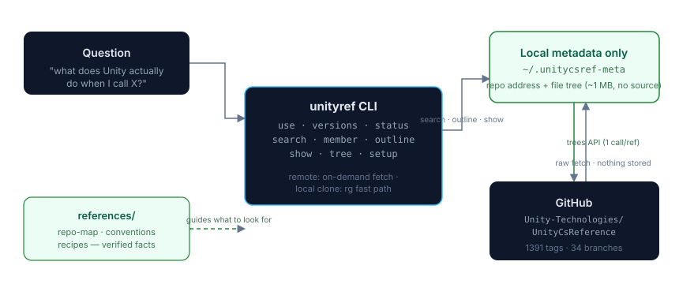

# unity-source-explorer

[](https://github.com/song-chaoyang/unity-source-explorer/actions/workflows/ci.yml)
[](LICENSE)
[](https://www.python.org/)
[](unity-source-explorer/scripts/unityref.py)
[](https://github.com/Unity-Technologies/UnityCsReference)
[](https://github.com/song-chaoyang/unity-source-explorer/releases/latest)

[English](README.md) | **简体中文**

> **零下载**探索**真正的 Unity 引擎 C# 源码**。本地只保存仓库地址和约 1 MB
> 的文件树索引;源码文件按需拉取、内存扫描、绝不落盘。1391 个 Unity 版本秒级
> 切换。可选的一条命令本地克隆,解锁全速全库搜索。
>
> 同时以独立 CLI 和**可安装技能包**两种形态发布——`unity-source-explorer.skill`
> 见 [Releases](https://github.com/song-chaoyang/unity-source-explorer/releases/latest)。

每个 Unity 开发者迟早会问:*"我调用这个 API 时,Unity **到底**做了什么?"*
文档只描述契约;引擎源码才是真相——Unity 以
[UnityCsReference](https://github.com/Unity-Technologies/UnityCsReference)
公开了引擎的 C# 层。但它是个 100 MB 的大仓库,目录结构随版本变化,核心类
放在 `*.bindings.cs` 文件里而不是 `TypeName.cs`,而且没有任何东西告诉你
"东西都在哪"。

**unity-source-explorer** 把这个仓库变成一个可查询的知识库:

| 需求 | 命令 |
|---|---|
| 开箱即用——无需安装任何东西 | `unityref status`(拉取约 1 MB 文件树索引) |
| 秒切 Unity 版本 | `unityref use 2022.3` · `use 6000.6.5f1` · `use latest-stable` |
| 某个类型声明在哪? | `unityref search --def RectTransform` |
| 某个成员声明在哪? | `unityref member Transform position` |
| 9700 行的大文件里有什么? | `unityref outline Editor/Mono/EditorGUI.cs` |
| 带行号读取指定片段 | `unityref show <path> --from 26 --to 33` |
| 这段代码是托管的还是引擎原生的? | 大纲标记 `[extern]` `[native]` `[serialized]` |
| 都有哪些模块? | `unityref tree Modules --depth 1` |
| 进阶:完整本地克隆(可选) | `unityref setup` |

## 快速上手

```console
$ unityref status
Mode:     remote (no Unity source stored locally)
Repo:     https://github.com/Unity-Technologies/UnityCsReference.git
Ref:      master
Tree:     8777 files, 8756 C# (~101 MB upstream) - paths+sizes cached at ~/.unitycsref-meta/trees/

$ unityref use 6000.6.5f1
Success: now using tag 6000.6.5f1 (remote mode - no source downloaded, switched instantly)
Tree:     8099 files, 8073 C# sources

$ unityref search --def RectTransform
Runtime/Transform/ScriptBindings/RectTransform.bindings.cs:125:    public sealed class RectTransform : Transform
1 match in 1 file
ref: 6000.6.5f1 (remote mode - files fetched on demand, nothing stored)

$ unityref show Runtime/Transform/ScriptBindings/Transform.bindings.cs --from 26 --to 33
Runtime/Transform/ScriptBindings/Transform.bindings.cs (508 lines) - showing 26..33
   26|         public extern Vector3 position { get; set; }
   28|         // Position of the transform relative to the parent transform.
   29|         public extern Vector3 localPosition { get; set; }
   ...
```

`outline` 同样带 1 起始行号与标记——`[extern]` 表示成员实现是原生 C++
(不在此仓库),`[native]` 表示带原生绑定特性,`[serialized]` 表示序列化指令。

## 工作原理



- **本地状态 = 仓库地址 + 文件树,仅此而已。** 每个检出版本只需一次 GitHub
  trees API 调用,缓存全量"路径+大小"列表(约 0.6 MB)于 `~/.unitycsref-meta`。
- **文件按需拉取**:从 raw.githubusercontent.com 取回、内存扫描、输出、丢弃。
  磁盘上永远只有元数据。
- **可选本地克隆**:`setup` 浅克隆完整源码(约 100 MB)。只要发现克隆
  (`--root`、`UNITY_CS_REF_PATH`、当前目录探测、`~/.unitycsref`)就自动优先
  使用——ripgrep 速度的全库搜索、离线可用、正则随处可跑。删掉克隆即回到
  remote 模式,历史元数据不受影响。
- **references**:经过实证的仓库结构地图、原生绑定管线、任务配方,教会
  工具(和使用者)*该往哪里看*。

## 安装

**作为独立 CLI 使用**

```bash
git clone https://github.com/song-chaoyang/unity-source-explorer.git
cd unity-source-explorer
python3 unity-source-explorer/scripts/unityref.py status
```

Python 3.8+,零第三方依赖。可选:ripgrep(仅本地克隆模式)、`GITHUB_TOKEN`
环境变量(远程全库文本搜索)。

**作为技能包使用**

从 [Releases](https://github.com/song-chaoyang/unity-source-explorer/releases/latest)
页面下载 `unity-source-explorer.skill`,任何支持 `.skill` 格式的 CLI 均可安装;
包内 SKILL.md 教授完整工作流、命令与阅读策略。

## 仓库内容

```
unity-source-explorer/          技能本体
├── SKILL.md                   工作流 + 命令参考
├── scripts/unityref.py        CLI(单文件,纯标准库)
└── references/                经过实证的知识
    ├── repo-map.md            按版本纪元的"东西都在哪"地图
    ├── conventions.md         m_/s_/k_ 命名、extern 与绑定管线
    └── recipes.md             任务配方(序列化、协程、UGUI 等)
tests/test_unityref.py          测试套件(单测离线可跑,无需克隆)
docs/architecture.svg           上面的架构图
```

## 写进 references 的实证事实

- 核心类型声明在 `*.bindings.cs` 文件里——在新版本上
  `find -name Transform.cs` 什么都找不到。
- **UGUI**(Text/Image/Button/Graphic)**根本不在** UnityCsReference 里——它在
  独立的 [uGUI 包仓库](https://github.com/Unity-Technologies/uGUI)。
- 1391 个版本 tag + 34 个维护分支(`2017.1` … `7000.0` + `master`);
  仓库形态随纪元变化(2022.3 约 4.1k 个 .cs,7000 master 约 8.7k)。
- 老博客里的 `[WrapperlessIcall]` 在当前版本中已不存在。
- 2021.3 / 2022.3 检出会带 `ModuleOverrides/` 目录——6000+ 已移除。

## 说明

- **许可** —— 本项目采用 MIT。被探索的源码属于 Unity Technologies,遵循
  [Unity Reference-Only License](https://unity3d.com/legal/licenses/Unity_Reference_Only_License):
  本工具只在本地*读取*它;请勿再分发 Unity 的代码。
- **磁盘占用** —— remote 模式每个检出版本约 0.6 MB 元数据。可选本地克隆:
  约 100 MB,每额外取一个版本约 100–300 MB。
- **API 限额** —— trees API 未认证约 60 次/小时(每次切版本 1 次);
  raw 文件拉取不计额。重度使用请设置 `GITHUB_TOKEN`,它同时解锁远程全库
  文本搜索。
- **慢网络** —— `setup --remote <镜像URL>` 支持任意 git 镜像;remote 模式
  本身只需要 api.github.com 和 raw.githubusercontent.com 可达。
